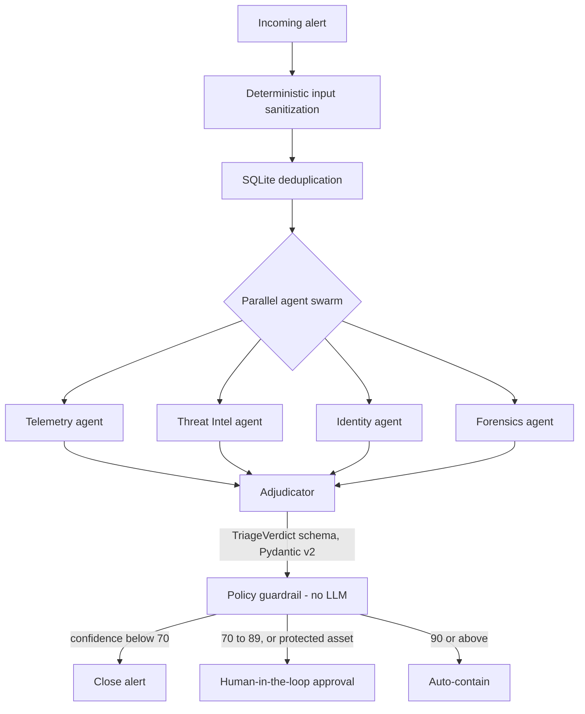

# Aegis-SOC

An autonomous, multi-agent alert triage and guardrailed incident-response engine for a Security Operations Center (SOC), built as a portfolio project.

> Status: `[FILL IN: e.g. design complete / prototype running / fully working]`. See [Current status](#current-status) for exactly what has and has not been verified.

---

1. What problem does it solve?

SOC analysts receive more alerts than they can investigate by hand, and each L1 triage follows a similar routine: check the telemetry, look up the indicators, check who the user is, look at the host, then decide to close, escalate or contain.

Aegis-SOC automates that routine. It gathers evidence in parallel, produces a structured verdict, and then applies a **fixed, non-AI policy** to decide what action is allowed. The AI recommends; deterministic rules decide.

2. How does it work?



Pipeline stages

1. Input sanitization (deterministic). Alert content is cleaned by ordinary code before any model sees it, to reduce the risk of prompt injection through attacker-controlled alert fields.
2. Deduplication. SQLite is used to avoid triaging the same alert twice.
3. Agent swarm (parallel, LangGraph). Four agents investigate at once:
   - *Telemetry*: related events from the SIEM
   - *Threat Intel*: reputation of IPs, domains and hashes
   - *Identity*: user and account context
   - *Forensics*: host-level evidence
4. Adjudicator. Combines the agents' findings into a single `TriageVerdict` (a Pydantic v2 schema), so the output is structured and validated rather than free text.
5. Policy guardrail (zero-LLM). Plain rules map the verdict to an action:

   | Condition | Action |
   |---|---|
   | Confidence < 70 | Close |
   | Confidence 70 to 89, **or** the asset is protected | Human approval (HITL) |
   | Confidence >= 90 | Auto-contain |

   The thresholds are code, not model output, so the model cannot talk its way into a containment action.

3. Tools and technologies

| Area | Choice |
|---|---|
| Language | Python 3.12 |
| API | FastAPI |
| Agent orchestration | LangGraph |
| Data validation | Pydantic v2 |
| Deduplication | SQLite |
| Target platform | Windows |
| SIEM / EDR (planned) | Wazuh / Elastic |
| Threat intel (planned) | VirusTotal, AbuseIPDB |
| Identity (planned) | Okta / Entra ID |
| Approval channel (planned) | Slack |

"Planned" means designed for but **not claimed as working** unless marked as verified in the status table below.

 4. How to reproduce the demonstration

> Replace every `[ ... ]` with the real value from your repo. Do not leave a command here that you have not run yourself.

Prerequisites: Windows, Python 3.12, Git.

```powershell
git clone [YOUR REPO URL]
cd [REPO FOLDER]
python -m venv .venv
.\.venv\Scripts\Activate.ps1
pip install -r requirements.txt
```

Configuration: copy `[.env.example]` to `.env` and fill in only the keys needed for the backends you want to try. `[State which mode works with no API keys, if any, e.g. a mock/sample-data mode.]`

Run:

```powershell
[command that starts the API, e.g. uvicorn ... ]
```

Send a sample alert:

```powershell
[command or curl.exe / Invoke-RestMethod example using a file from samples/]
```

Expected output: `[describe the TriageVerdict and action you actually get for the sample alert]`

5. Evidence

Each claim below should link to something a reader can open or re-run. Leave a row as "Not yet verified" rather than filling it with a guess.

| Claim | Evidence | How to re-run |
|---|---|---|
| Sanitization step works | `[test file / output]` | `[command]` |
| Agents run in parallel | `[log or test]` | `[command]` |
| Verdict matches the TriageVerdict schema | `[test]` | `[command]` |
| Policy guardrail maps confidence to action as in the table | `[test covering 69, 70, 89, 90 and a protected asset]` | `[command]` |
| Runs on Windows | `[OS version, Python version, date tested]` | Section 4 |

Supporting material (add only what exists):
- `docs/architecture.png`: architecture diagram
- `docs/screenshots/`: sanitized screenshots (no real IPs, hostnames, usernames, keys or tenant IDs)
- `docs/sample-queries.md`: example alerts and queries used in the demo
- `docs/test-results.md`: raw test output with date and environment

6.Current status

| Component | Status |
|---|---|
| Sanitization | `[Not yet verified / Verified]` |
| SQLite dedup | `[Not yet verified / Verified]` |
| Four-agent swarm | `[Not yet verified / Verified]` |
| Adjudicator + TriageVerdict | `[Not yet verified / Verified]` |
| Policy guardrail | `[Not yet verified / Verified]` |
| Wazuh / Elastic integration | `[Planned / Mocked / Verified]` |
| VirusTotal, AbuseIPDB | `[Planned / Mocked / Verified]` |
| Okta / Entra ID | `[Planned / Mocked / Verified]` |
| Slack HITL | `[Planned / Mocked / Verified]` |

7. Limitations

State these plainly; recruiters read honesty as competence.

- Any integration marked Planned or Mocked above has not been tested against a real production system.
- `[No accuracy or false-positive/false-negative rates have been measured. Add measured numbers here only if you have run an evaluation, and say on what data.]`
- Auto-containment is a design feature, not something tested against live infrastructure `[edit if untrue]`.
- Verdict quality depends on the language model used and the quality of the evidence returned by each backend.
- `[Add any other limits you know of, e.g. single-node only, no authentication on the API, tested on one Windows version.]`

8. Repository layout

```
[paste the real folder tree here]
```

9. Author

Rushikesh Kulkarni: aspiring SOC analyst. worldcybereyes@gmail.com
